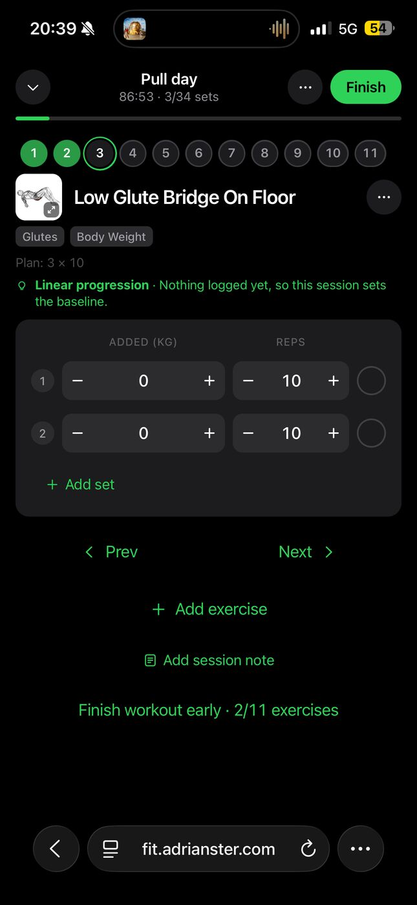
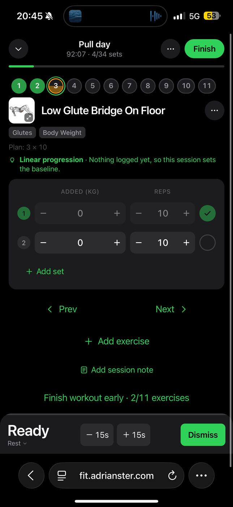

# Active workout screen redesign (cards layout)

> **Status: proposal, not started.** Nothing here describes current behavior. For how the screen
> works today, read [Workout views](LIST_VIEW.md). This document is the ticket: the problem, how
> we reasoned about it, what we decided and what we rejected, so whoever picks it up does not have
> to re-derive any of it.
>
> Issues are disabled on this repository, which is why this lives in `docs/dev/` and is carried by
> a draft PR. Move it to a tracker if you use one.

## 1. Context

The active workout screen is `ActiveWorkout` in `frontend/src/views/Workout.jsx`. It opens when a
workout starts and stays open for 60 to 90 minutes, used in short bursts between sets, usually
one-handed, with sweaty hands and a quick glance at the phone. Everything about this redesign is
judged against that situation, not against how it looks in a static screenshot.

The product intent is a native-feeling app (installable PWA, Capacitor shells). The screen
currently reads as a web page. That is the whole motivation: it is a design and interaction
problem, not a functional one. Almost every capability on the screen is fine and must keep working.

Screenshots of the current screen (cards layout, Safari, 390pt-wide phone):

| Idle (set 1 of exercise 3 about to start) | Resting (set 1 ticked, "Ready" timer) |
|---|---|
|  |  |

## 2. Diagnosis

Five root causes, not a list of nitpicks. Each visible symptom traces back to one of them.

### 2.1 There is no visual hierarchy

Title, muscle/equipment tags, plan line, progression hint and the set card all sit at similar
visual weight with uneven gaps between them. The eye has no entry point and no order: it is not
obvious what to read first (which exercise am I on) or what to touch next (the set check).

- The exercise title, the two tag pills, the "Plan: 3 × 10" line and the green progression hint
  stack with tight, inconsistent spacing, then a large gap, then the set card.
- The accent green is used for the progression hint, the Prev/Next links, Add exercise, the
  Finish pill, the Finish-early link and the done state. When everything is green, nothing is.
- The progression hint occupies a full-width, wrapped, green line even when it says nothing
  actionable ("Nothing logged yet, so this session sets the baseline."). That is prime space
  spent on a non-message.
- The set rows are the thing you touch hundreds of times per workout, and the check circle is
  roughly 27pt wide (measured from the screenshot, approximate), under the usual 44pt minimum
  touch target, pushed to the far right edge.

### 2.2 Navigation uses web idioms

- The numbered exercise chips (`WorkoutChips.jsx`) read as web pagination. They are also tappable
  jump targets that look like decoration.
- Prev and Next are text links with chevrons (`Workout.jsx` around the `navigateUnit` buttons),
  not buttons: no filled shape, no obvious hit area.

### 2.3 The same action lives in several places

- **Add exercise**: header ⋯ menu (`openViewMenu`) **and** a button mid-page.
- **Add session note**: header ⋯ menu **and** a button mid-page.
- **Finish**: the header "Finish" pill **and** a "Finish workout early · 2/11 exercises" link at
  the bottom of the page.

Three duplicated actions, scattered in the middle of the page, add noise and no capability.

### 2.4 The primary call to action is always on

The header Finish is a solid green primary button from the first set. Finishing is relevant at
the end, or deliberately early. Having the loudest button on screen be the one you least want to
hit by accident, for 90 minutes, is backwards. (It also competes with the real primary action:
ticking the next set.)

### 2.5 Two progress measures compete

The header says "3/34 sets" (with a progress bar under it). The bottom says "2/11 exercises".
Both are useful, but showing both as equals in different corners makes neither read as *the*
progress. Elapsed time (86:53), which matters mid-workout, is the smallest text in the header.

### 2.6 Smaller observations

- The timer docks well already, but in the resting screenshot it overlaps the bottom of the page
  with no relationship to any navigation, and its "Ready / Rest ▾" label is ambiguous.
- The weight column reads "ADDED (KG)" with 0 for a bodyweight move. **Decision: this stays**
  (see 5.7). It is documented here only because it was noticed.
- The screenshot shows "Plan: 3 × 10" with only two set rows. See section 9.1: this is almost
  certainly a display quirk, not data loss.

## 3. What the code already does (constraints that shaped the proposal)

Reading the code before designing changed several of our assumptions. These are facts, not
preferences, and any implementation has to respect them.

- **The tab bar is already hidden on the workout screen.** `RestTimer.jsx` documents this
  ("the workout screen … has no tab bar, see App.jsx") and it matches the screenshots. The
  question "should the nav bar hide during a workout?" is already answered; no work needed.
- **The rest timer is already a docked bottom bar** (`RestTimer.jsx`, `#timer` in
  `index.css`): clock, −15, +15, pause, Skip/Dismiss, progress along its top edge. While it is
  on, `body.resting` adds bottom padding (`index.css`, 166px + safe area) so the last set and the
  Finish button can scroll clear. The new nav dock has to coexist with this, not replace it.
- **Four layouts exist: `cards`, `list`, `compact`, `focus`** (`S.workoutView`, overridable per
  session from the header ⋯ menu). Prev/Next only exists in `cards` and `focus`. `list` and
  `compact` stack every exercise and navigate by a "Set current" chip. A footer dock with Prev/Next
  only makes sense where there is a "current exercise to page from".
- **Exercise chips are already optional.** `WorkoutChips.jsx` is gated by `wc.exerciseChips`
  (Settings → During a workout → Workout controls). Their state logic is a pure helper:
  `exerciseChips` / `entryProgress` in `lib/exercise-chips.js` ('todo' | 'partial' | 'done',
  supersets as one unit, warm-ups do not hold a chip back). That data is reusable as-is for a
  jump sheet.
- **Swipe navigation already exists** (`SwipeCards.jsx`): the current card slides, and the
  neighbouring card is previewed. Swipe is not part of the problem.
- **Exercise-level actions are already in each exercise's ⋯ menu** (swap, move, remove, notes,
  history, progression settings). The inline Move up / Move down / Swap / Remove footer only
  shows when `wc.exerciseButtons` is on; the user's screenshots have it off.
- **Supersets are one unit.** Prev/Next navigate units, not entries (`navigateUnit` goes through
  `supersetUnits`). A superset renders as one card containing several exercises.
- **Two non-live modes change the footer's job.** Editing a saved workout (`A.editingWorkoutId`)
  replaces Finish with Save and closes with ✕ instead of ⌄. Backfilling a past workout
  (`A.backfill`) has no rest timer at all (`startRest` is a no-op). Both must keep working.
- **Finish already has a good safety net.** `finishWorkoutSheet` offers Finish and save, or
  Discard. That friction is correct for finishing early and should be reused.
- **Dependency-light is a hard rule** (CONTRIBUTING.md): no new libraries. The whole redesign is
  CSS plus React in files that already exist.
- **Tests are heavy here.** `Workout.test.jsx` is ~3.4k lines plus a dozen `Workout.*.test.jsx`
  files. Many query by the visible text or label ("Prev", "Next", "Finish workout early", chips).
- **Locale checks run in CI.** Every added or changed string needs a catalogue entry.

## 4. Design principles we agreed on

1. **One obvious next action.** On this screen that is "tick the next set". Everything else is
   quieter than it.
2. **Capability over chrome.** Remove duplicates and decoration, not features. If a user could do
   it before, they can do it after.
3. **Thumb-first, mid-set.** Primary controls live in the bottom third, with large hit areas.
   Destructive and rare actions are one deliberate step away, never one stray tap.
4. **One place per action.** Each action is reachable from exactly one obvious place (plus its
   existing shortcut, if it has one).
5. **Native idioms.** Filled buttons for actions, a bottom dock, sheets for secondary tasks,
   swipe for paging. Not links and pagination chips.
6. **Do not break the working parts.** Swipe, supersets, editing/backfill, the four layouts, the
   rest timer behavior and the settings that exist stay.

## 5. Decisions and reasoning

Each decision records what we chose, why, and what we considered and rejected. The rejected
options are listed on purpose, so they are not re-proposed without new information.

### 5.1 Keep the ability to jump to any exercise, but move it out of the main surface

**Original ask:** replace the numbered chips with carousel-style controls (drag to browse
exercises, or arrow buttons).

**Pushback and outcome:** we did not drop jump-to. A workout has up to ~11 exercises and people
skip around (a machine is taken, a shared rack). A drag carousel plus arrows is *slower* for that
than a tap on a number, and drag plus arrows is two controls for one job. The chips look bad
because they read as web pagination, not because jumping is wrong.

**Decision:**
- A single quiet position row: "Exercise 3 of 11" with a thin segmented strip (one segment per
  unit, filled by `exerciseChips` state, current segment emphasised).
- Tapping that row opens an "All exercises" sheet: the full ordered list with each exercise's
  status, tap to jump. This reuses `exerciseChips` and keeps the capability.
- Paging stays on the card: swipe (existing `SwipeCards`) and the dock buttons (5.2).

**Rejected:** (a) delete jumping and rely on Prev/Next, which makes "go to exercise 9" eight
taps; (b) drag carousel plus arrows at the top, which is redundant with swipe and the dock;
(c) keep the chip strip and restyle it, which still leaves small, decorative-looking tap targets
in the most-looked-at spot of the screen. `wc.exerciseChips` stays as the existing opt-in for
people who like the strip.

### 5.2 Prev / Next become icon buttons in a bottom dock

Prev and Next are links today. They become real, filled, thumb-reach buttons in a fixed footer
dock. Default dock content is **Prev | Next**.

Disabled states: Prev is disabled on the first unit, Next on the last (as today). On the last
unit, see 5.3.

**Rejected:** keeping text links (the original complaint); a floating circular "next" button
(hides content, collides with the timer and with swipe).

### 5.3 Finish is not between Prev and Next

**Original ask:** the dock could be "Prev · Finish · Next" by default.

**Pushback and outcome:** Finish between the two navigation buttons will be hit by accident.
The thumb heads for Next with one set left, the target is the same height and next to it, and
the cost is ending a workout. We kept the dock to Prev | Next and gave Finish a *state*:

- Units 1 to N−1: dock is **Prev | Next**. Finish is not in the dock.
- Last unit, or all sets done: **Next turns into the primary Finish action** (same slot,
  filled). It opens the existing `finishWorkoutSheet`, not an immediate save.
- Finishing early: from the header ⋯ menu (and the existing Finish sheet's confirmation). That
  deliberate step is the right amount of friction.
- Editing a saved workout: the primary action is **Save** and closes the editor, as today.

The header "Finish" pill is removed from the always-visible area. This also resolves 2.4.

**Rejected:** Finish always in the dock centre (misfire risk, still on all session); Finish
only in ⋯ (no obvious way to end a completed workout); keeping the header pill (the always-on
primary CTA we are trying to remove).

### 5.4 The rest timer stacks above the Prev / Next row

**Decision (the user's call):** the rest timer is added **on top of** the Prev | Next dock row.
It is a second row above it, not a replacement for it.

**Why:** the rest between sets is exactly when you want to move on or look ahead. If the timer
replaced the nav row, Prev/Next would disappear for the whole rest (often 60 to 180 seconds)
and come back only after dismissing the timer, which defeats the dock. Stacking keeps both
reachable. The timer keeps its existing controls (−15, +15, pause, Skip/Dismiss) unchanged.

**Cost, stated honestly:** the dock grows to two rows while resting, which takes vertical space
on small phones. `body.resting` bottom padding (currently 166px + safe area) was sized for the
timer alone and must grow to cover timer + nav row, or the last set and the Finish/Save button
scroll under it. Treat that as an acceptance criterion (section 8).

**Not decided:** whether the timer row visually attaches to the nav row (one shared container,
separated by a hairline) or reads as two stacked bars. Prefer one container; designer's call.

### 5.5 Secondary actions use sheets on the same route

**Question we weighed:** should "Add exercise", "Add note" and "Finish early" open as a sheet, or
as a separate page with its own navbar and routing?

**Decision:** sheets, one route. The workout state, the running timer and the back stack all live
on this screen; a separate page means re-establishing them and showing a second navbar for a
task that takes ten seconds. Concretely:
- **Add exercise**: header ⋯ menu → full-height sheet with search (the existing
  `exercisePicker`). No duplicate button on the page.
- **Session note**: header ⋯ menu → small sheet (the existing `sessionNoteSheet`). No duplicate
  button on the page.
- **Finish early**: header ⋯ menu → the existing Finish sheet.
- **Exercise actions** (swap, move, remove, notes, progression): the exercise's own ⋯ menu,
  already there. The inline footer rows (`wc.exerciseButtons`) are untouched.

**Rejected:** a separate "workout tools" page (state and timer handling, extra navbar); moving
the three actions into the dock (they are infrequent and would crowd out Prev/Next).

### 5.6 One progress measure, one place

Keep **sets** (`done/total`, already in the header) as the one primary measure, with the single
progress bar under the header. Exercise position is carried by the "Exercise 3 of 11" row (5.1).
The bottom "2/11 exercises" text is dropped with the Finish-early link it belongs to. Elapsed
time is promoted visually (tabular, larger) because it is the number people check.

### 5.7 "Added (kg)" stays

We initially proposed showing "Bodyweight" instead of "Added (kg): 0" for bodyweight moves.
**The decision is to leave the label as it is.** Do not change it as part of this work.

### 5.8 Tab bar: nothing to do

Already hidden on this screen (section 3). Recorded so nobody re-opens it.

### 5.9 Progression hint becomes a quiet line

The "Plan: 3 × 10" line and the progression hint are merged into one muted context line under
the title. The hint is only shown when it carries information (a target to beat, a deload, an
added set), and is hidden for the "Nothing logged yet" baseline case. It should not use the
accent green that primary actions use.

### 5.10 Wording: "workout" vs "routine"

The screen is a workout/session; a routine is the plan template ("Pull day" is the routine's
name, which is fine as a subtitle). The UI copy for starting and describing this flow should say
*workout*. The code already separates `RoutineEdit` (the template) from the workout views, so
this is a copy and locale change. **Not decided by the user yet**: see open question 9.2.

## 6. Target design

Wireframes are intentionally low-fidelity. They fix structure and hierarchy, not pixels, colors
or exact spacing.

### 6.1 Mid-workout, no rest running

```
┌───────────────────────────────────────┐
│ ⌄        Pull day               ⋯     │  header: minimise, name, menu
│          1:32:07 · 4/34 sets          │  elapsed (prominent) + set count
│ ▬▬▬▬▬░░░░░░░░░░░░░░░░░░░░░░░░░░░░░░░░ │  one progress bar (sets)
│                                       │
│ Exercise 3 of 11                   ▾  │  position row, taps → All exercises sheet
│ ▬▬ ▬▬ ▰▰ ▭▭ ▭▭ ▭▭ ▭▭ ▭▭ ▭▭ ▭▭ ▭▭      │  segmented strip (done / current / todo)
│                                       │
│ [thumb] Low Glute Bridge On Floor  ⋯  │  large title; exercise ⋯ menu
│         Glutes · Body weight          │  one quiet subtitle line
│                                       │
│ Target 3 × 10  ·  progression note    │  one muted line (hint only if useful)
│ ┌───────────────────────────────────┐ │
│ │ ADDED (KG)           REPS         │ │
│ │ 1 [ − 0 + ]        [ − 10 + ]  ( ✓)│ │  large check targets (≥ 44pt)
│ │ 2 [ − 0 + ]        [ − 10 + ]  ( ○)│ │
│ │ ＋ Add set                        │ │
│ └───────────────────────────────────┘ │
│                                       │
├───────────────────────────────────────┤
│ [   ‹  Prev   ]     [   Next  ›   ]   │  dock: icon+label buttons
└───────────────────────────────────────┘
```

### 6.2 Resting: timer stacked above the nav row

```
├───────────────────────────────────────┤
│ 0:45  Rest ▾     [−15][+15] [⏸] [Skip]│  existing RestTimer, unchanged controls
├───────────────────────────────────────┤
│ [   ‹  Prev   ]     [   Next  ›   ]   │  nav row stays reachable during the rest
└───────────────────────────────────────┘
```

### 6.3 Last exercise, or all sets done

```
│ [   ‹  Prev   ]     [  Finish workout ]│  Next becomes the primary action (filled)
```

### 6.4 States that must keep working

| State | Header | Dock |
|---|---|---|
| Live, exercises 1…N−1 | name, elapsed, sets, progress | Prev \| Next |
| Live, last exercise or all done | same | Prev \| **Finish** (opens Finish sheet) |
| Superset unit | same, card shows the whole unit | Prev \| Next move by *unit* |
| Editing saved workout | ✕ instead of ⌄, "Editing a saved workout" note | Prev \| **Save** on the last unit |
| Backfill (past workout) | date instead of elapsed | no timer row; same nav |
| `list` / `compact` layouts | unchanged | **out of scope for this change** (see 7) |

## 7. Scope

**In scope:** the `cards` layout of the active workout screen. Header, position row, exercise
header, context line, dock (including timer stacking), removal of the three duplicate controls,
the "All exercises" sheet.

**Open scope question (9.3):** the `focus` layout also uses Prev/Next and a header; it will
probably adopt the same dock and header for free. The `list` and `compact` layouts navigate
differently and are explicitly not part of this change.

**Out of scope:** changing the "Added (kg)" label (5.7); changing progression logic; changing
rest timer behavior or its controls; changing what Settings → During a workout offers; new
dependencies.

## 8. Implementation map

Where the pieces are today, so the change can be planned without re-exploring.

| Concern | Where |
|---|---|
| Screen composition (header, chips, card, footer buttons) | `frontend/src/views/Workout.jsx`, `ActiveWorkout` (header ~`whdr`, chips `chipRow`, cards via `SwipeCards`, footer buttons at the end of the render) |
| Header ⋯ menu (Add exercise, Add session note, Layout, Discard) | `openViewMenu` in `Workout.jsx` |
| Prev/Next behavior, superset-aware | `navigateUnit` in `Workout.jsx` (uses `supersetUnits`) |
| Exercise status data for the strip and the jump sheet | `frontend/src/lib/exercise-chips.js` (`exerciseChips`, `entryProgress`) |
| Chip row component (kept as opt-in) | `frontend/src/components/WorkoutChips.jsx` |
| Swipe paging | `frontend/src/components/SwipeCards.jsx` |
| Rest/work timer bar | `frontend/src/components/RestTimer.jsx`, `#timer` rules in `frontend/src/index.css` |
| Bottom space reserved while resting | `body.resting #app` in `index.css` |
| Finish flow | `finishWorkoutSheet`, `finishWorkout`, `discardWorkout` (`sheets.jsx` / `Workout.jsx`) |
| Layout settings (`workoutView`, `wc.*`) | `workoutControls(S)` consumers in `Workout.jsx`, `docs/dev/LIST_VIEW.md` |

Approach: put the dock in its own small component rendered by `ActiveWorkout` so the nav row
and the timer row are laid out together (one fixed container, two rows), instead of two
independent fixed elements fighting over the bottom edge.

### Tests and strings

- The many `Workout.*.test.jsx` suites that find controls by "Prev", "Next", "Finish workout
  early", the header Finish, or the chips will need updating. Update them to the new controls;
  do not delete coverage. The pure logic (chips state, `navigateUnit`) is unchanged, so its tests
  should keep passing as-is.
- New pure logic (for example "what does the dock's primary action say in this state") should be
  a helper in `src/lib` with a unit test beside it, per CONTRIBUTING.md.
- Every new or changed string needs an entry in the locale catalogue, and the locale checks in
  CI must pass.
- Verify RTL: the Prev and Next chevrons and the dock order must mirror correctly in RTL
  locales (the app has RTL handling; this is easy to get wrong with icon-only buttons).

## 9. Open questions and findings

### 9.1 "Plan: 3 × 10" with two set rows (investigated, likely benign)

The screenshot shows "Plan: 3 × 10" while the card has two rows. Reading the code:

- The plan line (`planLine` in `ExerciseBlock`, `Workout.jsx`) compares the plan with the
  entry's **target** (`entry.target.sets`) and appends " · today 2 × 10" only when the target
  differs from the plan.
- Deleting a set (`deleteActiveSet`) removes the row from `entry.sets` only. It does not touch
  `entry.target.sets`. So after a set is removed by hand, the target still says 3, the line still
  says "Plan: 3 × 10", and no "today" note appears, while the card shows two rows.

This is a display inconsistency, not data loss: the session has two sets and that is what is
logged. It is **unconfirmed** that this is what happened in the screenshot (we have not seen the
session). Worth deciding, as part of the context-line change in 5.9, whether the line should
reflect the rows actually present. Please confirm whether a set was deleted in that session.

### 9.2 Naming

Do we rename the user-facing flow to "workout" (Start workout, etc.) while keeping "routine" for
the template? Not decided.

### 9.3 Scope across layouts

Cards only, or cards plus focus (which already shares Prev/Next)? Recommendation: cards first,
let focus inherit the header/dock if it falls out naturally, leave list and compact alone.

### 9.4 Dock container

One shared container for the timer row and nav row, or two stacked bars? Recommendation: one
container, hairline between rows.

### 9.5 Header Finish removal

With the Finish pill gone from the header, confirm that ending a completed workout via the dock
(and an early finish via ⋯) is discoverable enough, or whether a subtle "Finish" should remain
in the header only once all sets are done.

## 10. Acceptance criteria

- [ ] No duplicate controls on the page: Add exercise, Add session note and Finish early exist
      only in the header ⋯ menu; the mid-page buttons and the "Finish workout early" link are gone.
- [ ] The accent green is reserved for primary actions and done states: the progression hint and
      secondary controls no longer use it.
- [ ] Prev/Next are filled buttons in a bottom dock with ≥ 44pt hit areas; Prev is disabled on
      the first unit; behavior is identical to `navigateUnit`, including supersets.
- [ ] On the last unit or when all sets are done, the dock's primary action is Finish (or Save
      when editing) and opens the existing Finish sheet / saves as today.
- [ ] Header shows elapsed time prominently, one set counter and one progress bar; there is no
      always-visible Finish pill.
- [ ] "Exercise N of M" row with a segmented strip; tapping it opens an All-exercises sheet that
      shows each exercise's status and jumps on tap (superset counted as one unit).
- [ ] While resting, the timer row sits above the nav row; both stay tappable; the last set and
      the primary action can scroll fully clear of the combined dock on a small phone (check the
      `body.resting` padding, safe area, and the native keyboard offset).
- [ ] Swipe paging still works; swiping and the dock buttons agree on the current exercise.
- [ ] Set check targets are ≥ 44pt and the "ADDED (KG)" label is unchanged.
- [ ] Editing a saved workout and logging a past workout both still work (Save, no timer).
- [ ] `list` and `compact` layouts are unchanged.
- [ ] Existing suites updated, new pure logic unit-tested, locale checks pass, no new
      dependencies, RTL checked.
